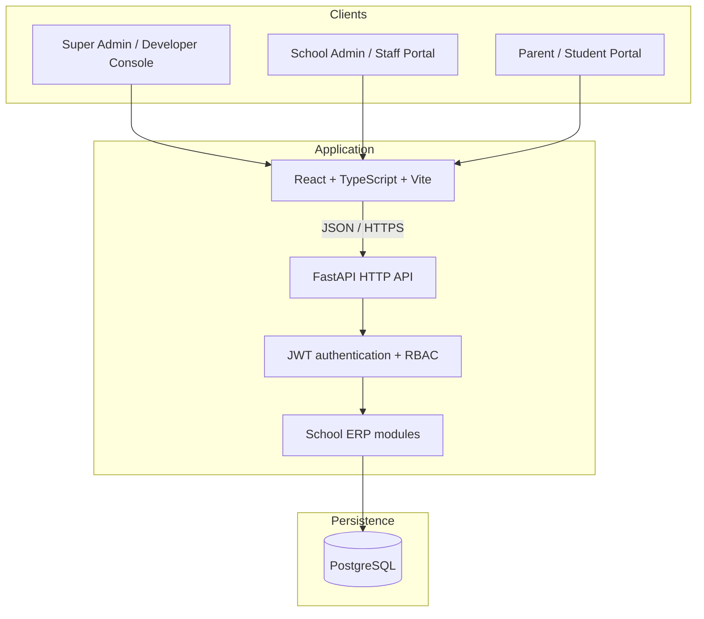

# SchoolOS architecture and implementation notes

## Logical architecture

The implementation is a **modular monolith**. The diagram's conceptual services (student, staff, finance, facilities, chatbot) are represented as API domains inside one FastAPI application. This is intentional for the current deployment size: it avoids service-discovery and distributed-transaction complexity while allowing later extraction.

## Tenancy model

- A school is represented by the `schools` table.
- School-owned records use `school_id` as their tenant discriminator.
- Super Admin is a global role and may manage schools across tenants.
- School users must be assigned to a school; endpoints apply tenant filters using the authenticated user's `school_id`.
- Creation APIs assign the caller's tenant ID rather than trusting client-supplied tenant IDs.
- Related-record validation must verify that both parent and child records belong to the same school.
- Legacy data migration assigns records without a school to a dedicated legacy school before making tenant IDs mandatory.

**Security invariant:** every read, update, delete, import, report, and relation lookup for school-level users must be scoped to their tenant. New endpoints must use the same rule and include cross-tenant negative tests.

## School code login and mandatory privileged-account MFA

- Every sign-in requires a school code, email address, and password.
- The backend resolves the active school from the normalized school code and matches the user by both email and school_id; the school code is never trusted as a frontend-only filter.
- Global Developer (super_admin) accounts sign in with the configured PLATFORM_SCHOOL_CODE (default: PLATFORM) and have no school tenant assignment.
- Admin and Developer accounts always receive a six-digit email MFA challenge after password, email-verification, account-approval, and active-account checks. No access token is issued until /api/auth/verify-mfa consumes the one-time code.
- MFA challenges expire after five minutes; email codes expire after ten minutes and allow at most five attempts. Existing 60-second resend throttling applies.
- Teacher, Accountant, Transport Manager, Hostel Warden, and Parent accounts retain the existing password-only sign-in after the same email-verification and Admin-approval checks.
- School/staff registration, email verification, Admin approval, resend verification, and password recovery endpoints remain unchanged.
- Configure PLATFORM_SCHOOL_CODE in the backend environment and distribute it only to authorized Developer operators. Never use a school tenant's code for a global Developer account.

## Parent portal and help assistant

- Parent accounts are linked explicitly to student records through `parent_student_links`.
- School admins and Super Admins create links using `POST /api/parent-links`; parent and student must belong to the same school.
- Parent users can list linked students and retrieve only those students' fee records through `/api/parent/children` and `/api/parent/children/{student_id}/fees`.
- The FAQ assistant is a deterministic approved-answer endpoint (`POST /api/chatbot/faq`), not a generative AI integration. It avoids retrieving personal student information and returns a handoff suggestion for unknown questions.

## Module/API map

| Domain | Current API routes |
|---|---|
| Authentication | `/api/auth/login`, `/api/auth/me` |
| Dashboard | `/api/dashboard` |
| Schools / tenant onboarding | `/api/schools` |
| User administration | `/api/users` |
| Students | `/api/students`, `/api/students/import` |
| Staff | `/api/staff` |
| Classes | `/api/classes` |
| Transport | `/api/vehicles` |
| Hostel | `/api/hostels` |
| Documents | `/api/documents` |
| Facilities / maintenance | `/api/maintenance` |
| Finance | `/api/fee-structures`, `/api/student-fees`, `/api/fee-dues`, `/api/fee-reports` |
| Fee payments | `/api/student-fees/{fee_id}/payments` |
| Parent app | `/api/parent-links`, `/api/parent/children`, `/api/parent/children/{student_id}/fees` |
| Chatbot FAQ | `/api/chatbot/faq` |
| Academic workflows | `/api/attendance`, `/api/timetable`, `/api/exams`, `/api/report-cards`, `/api/homework`, `/api/student-leave` |
| Parent leave portal | `/api/parent-portal/leave` (active parent-student links only) |
| Parent–teacher messaging | `/api/parent-messages` (school-scoped, sender/recipient-only) |

Most CRUD domains expose list, create, retrieve, update, and delete operations. See Swagger UI at `/docs` for the live OpenAPI contract.

## Deployment

Docker Compose runs the web frontend, FastAPI backend, and PostgreSQL database. Nginx serves the frontend and routes API requests. Keep PostgreSQL on a private Docker network; do not expose its port publicly in production.

Required production configuration:

- A unique long random `JWT_SECRET_KEY`
- A strong PostgreSQL password
- A non-default bootstrap admin email/password
- Exact trusted `CORS_ORIGINS`
- TLS termination at a trusted reverse proxy
- Encrypted backups and tested restore procedures
- Logs/metrics without passwords, tokens, student PII, or payment credentials

## Deliberate integration boundaries

These features require approved external services and are not enabled merely by adding a UI:

- Aadhaar identity verification
- Payment gateway authorization, capture, settlement, and reconciliation
- SMS/email/WhatsApp notifications
- AI chatbot provider and content safety controls
- Biometric attendance hardware
- GPS / vehicle tracking
- OCR and document scanning

Use provider adapters, server-side credentials, consent and compliance checks, idempotency, audit events, and integration tests when adding them.
